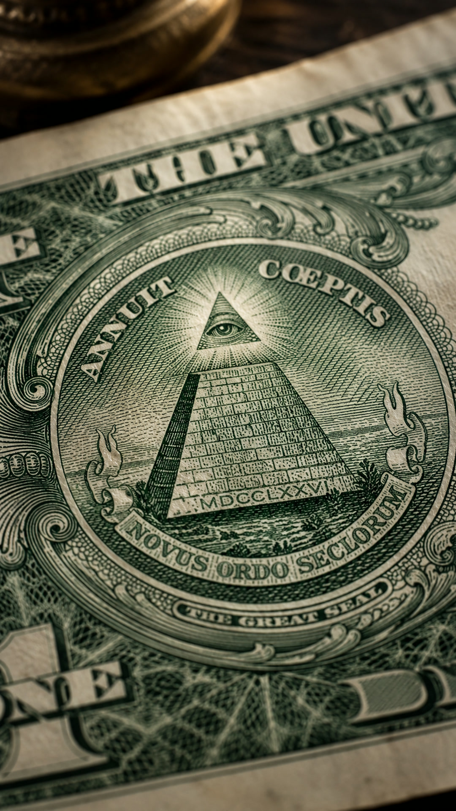
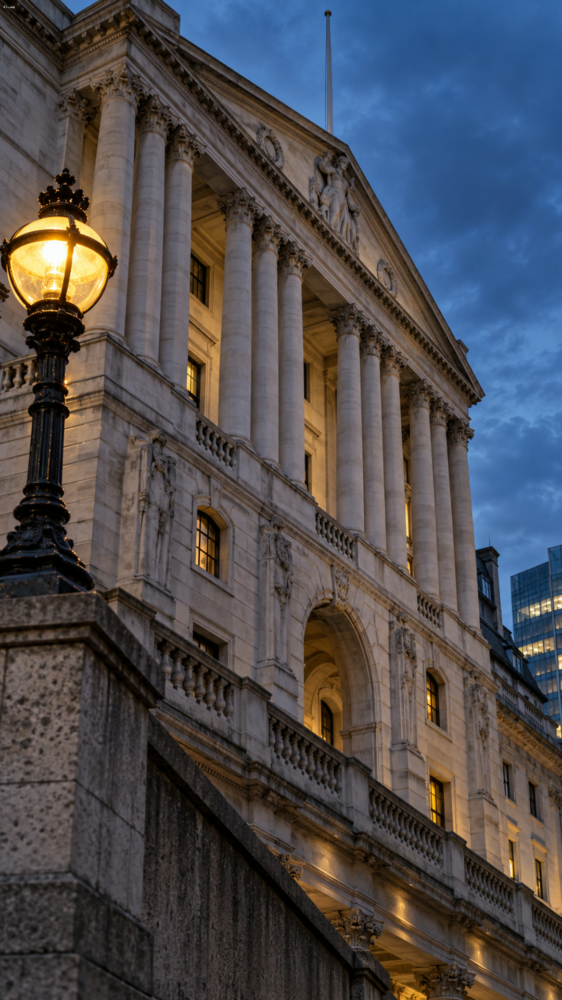
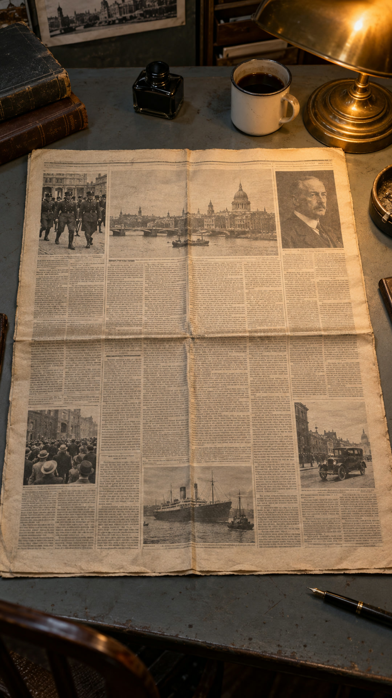
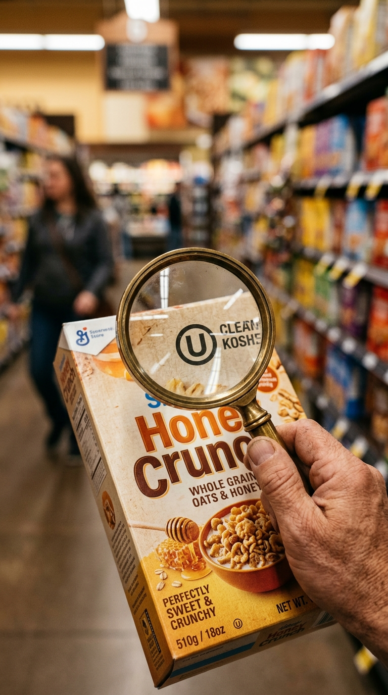
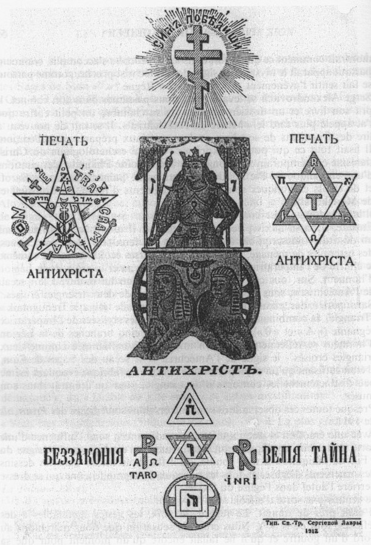

# 🏛️ Beyond The Myth: Big Claims, Actual Evidence

<p align="center">
  
</p>

<p align="center">
  <b>A Broadcast-Grade Cinematic Explainer Video Framework & Turnkey Production Suite</b><br>
  <i>Powered by HyperFrames, GSAP Timeline Engine, WCAG AA Contrast Guarantees, and Sidechain Audio Ducking</i>
</p>

<p align="center">
  <a href="https://github.com/luigilaxmaster-coder/beyond-the-myth"></a>
  <a href="#-episodic-gallery-season-2"></a>
  <a href="#-technical-standards--qa-matrix"></a>
  <a href="#-quickstart-how-to-use-as-a-base-for-your-videos"></a>
  <a href="LICENSE"></a>
</p>

---

## 🌟 What is Beyond The Myth?

**Beyond The Myth** is a full-stack open-source framework and reference production suite for creating cinematic, vertical documentary explainer videos (9:16 vertical, `1080x1920` @ 30fps, exactly 60.00 seconds per video).

Designed specifically for **AI coding agents** and human creators alike, this repository provides:
1. **The Complete 20-Episode Production Corpus:** 10 episodes of Season 1 (Historical Mysteries) and 10 episodes of Season 2 (*Big Claims, Actual Evidence*).
2. **Deterministic Web-to-Video Engine:** HTML, CSS, and GSAP timeline rendering compiled to broadcast-grade MP4s via [HyperFrames](https://github.com/heygen-com/hyperframes).
3. **Dual-Narrator Audio Mastering Pipeline:** Alternating voices (**Maya** and **Alex**), verbatim script synchronization, and procedural background music with **-12 dB sidechain ducking**.
4. **Automated Accessibility & Layout QA:** Every single frame passes 100% WCAG AA contrast checks, zero text clipping, zero letter-spacing jumps, and strict pivot stability.
5. **Turnkey Template Base:** Clone this repository and instantly start producing your own YouTube Shorts, TikToks, and Reels documentary explainers with modular widgets and customizable design systems.

---

## 📸 Episodic Gallery: Season 2 (*Big Claims, Actual Evidence*)

Every episode features 4 exclusive, photorealistic 9:16 vertical photographic plates, custom color palettes, and dedicated interactive widgets:

| Ep 01: Bank of England (1694) | Ep 02: Brooklyn Synagogue Tunnel | Ep 03: The Dollar Bill & Great Seal |
|:---:|:---:|:---:|
|  |  |  |
| **Hero Object:** Royal Charter Ledger (1694) & Nationalisation Act (1946) | **Hero Object:** NYC DOB Shoring Notice & 3D Trench Blueprint | **Hero Object:** 1782 Continental Congress Seal Matrix |

| Ep 04: The 9/11 '4,000 Absentees' Myth | Ep 05: Black Death & Poisoned Well | Ep 06: Capitalism vs Communism Dial |
|:---:|:---:|:---:|
|  |  |  |
| **Hero Object:** Cantor Fitzgerald 9/11 Memorial Registry | **Hero Object:** Papal Bull *Sicut Judaeis* (1348) & Yersinia Pestis HUD | **Hero Object:** Ideological Polarization Matrix & Balance Dial |

| Ep 07: Henry Ford & Dearborn Ind. | Ep 08: The 'Stab in the Back' Myth | Ep 09: Fake Social Media Surnames |
|:---:|:---:|:---:|
|  |  |  |
| **Hero Object:** Ford Model T Patent & 1927 Retraction Statement | **Hero Object:** German Supreme Command 1918 Telegram | **Hero Object:** Inquisition Sephardic Linguistic Archive |

<p align="center">
  <b>Ep 10: The Cropped 1933 Daily Express Headline</b><br>
  <br>
  <i>Hero Object: March 24, 1933 Uncropped Full Broadsheet Archive</i>
</p>

---

## 🏛️ Episodic Gallery: Season 1 Highlights

| Ep 02: Oak Island Chappell Vault | Ep 06: The Protocols Forgery Proof | Ep 09: J'accuse & Dreyfus Affair |
|:---:|:---:|:---:|
|  |  |  |

---

## 🛠️ Complete Tooling & Architecture

This repository includes the entire developer toolchain used to craft, animate, validate, and render the videos:

```
beyond-the-myth/
├── packages/                          # HyperFrames Core Engine & CLI
│   ├── cli/                           # Command-line interface (`hyperframes check/render/preview`)
│   ├── core/                          # Composition AST and compiler
│   ├── producer/                      # Headless Chromium frame capture & WebGL GPU pipeline
│   ├── player/                        # Interactive scrubber and preview player
│   └── studio/                        # Local Studio interface
├── .agents/skills/                    # AI Agent Automation Skills
│   ├── cinematic-explainer-video/     # Full-length documentary prompt contracts & layout rules
│   └── video-editing/                 # Neural & procedural video transformation
├── scripts/                           # Production Pipelines
│   ├── season_02_scripts.json         # Master verbatim scripts with word boundaries
│   ├── produce_season2_audios.py      # Dual-narrator audio generator + sidechain ducking (-12 dB)
│   ├── produce_season2_compositions.py# Deterministic HTML5/GSAP layout generator
│   ├── check_all_season2.py           # Automated WCAG AA contrast & layout compliance tester
│   └── render_and_deliver_season2.py  # GPU-accelerated 30fps batch renderer and FFmpeg muxer
├── beyond_the_myth_ep001/ ... ep020/  # 20 Independent Production Compositions
│   ├── index.html                     # Self-contained GSAP HTML composition
│   ├── captions.json                  # Synchronized word-level timing manifest
│   ├── subtitles.srt                  # Broadcast-grade subtitle file
│   └── assets/                        # High-resolution photorealistic plates, fonts, master audio
└── season_02_delivery_manifest.json   # Full production manifest with SHA-256 checksums
```

---

## 🚀 Quickstart: How to Use as a Base for Your Videos

### 1. Requirements
- **Node.js** v20 or v22+
- **Python** 3.10+
- **FFmpeg** (accessible in your system `PATH`)

### 2. Installation
Clone the repository:
```bash
git clone https://github.com/luigilaxmaster-coder/beyond-the-myth.git
cd beyond-the-myth
npm install
```

### 3. Preview Any Episode Locally
Launch the real-time preview player with timeline scrubbing:
```bash
npx hyperframes preview beyond_the_myth_ep011
```

### 4. Run Automated Quality Assurance
Verify 100% WCAG AA contrast compliance and layout safety:
```bash
npx hyperframes check beyond_the_myth_ep011
```

### 5. Render to 1080x1920 MP4
Render with GPU acceleration and high-quality delivery presets:
```bash
npx hyperframes render beyond_the_myth_ep011 -o renders/visual.mp4 --fps 30 --quality delivery --workers 2 --gpu
```

### 6. Mux Visual with Master Audio
Mux the rendered visual video with master audio:
```bash
ffmpeg -y -i renders/visual.mp4 -i assets/audio/master.wav -map 0:v:0 -map 1:a:0 -c:v copy -c:a aac -b:a 192k -ac 2 -ar 44100 -t 60 -movflags +faststart output.mp4
```

---

## 🎙️ Creating a New Episode From Scratch

To create your own video using this repository as a base:

1. **Duplicate an Episode Template:**
   ```bash
   cp -r beyond_the_myth_ep011 my_new_episode
   ```
2. **Add Your 4 Photographic Plates:**
   Place 4 high-resolution vertical images (9:16 aspect ratio) into `my_new_episode/assets/images/` as `scene_1.jpg`, `scene_2.jpg`, `scene_3.jpg`, and `scene_4.jpg`.
3. **Generate Master Audio:**
   Use `scripts/produce_season2_audios.py` to synthesize speech and apply sidechain ducking (-12 dB) to your background music.
4. **Customize the Hero Object Widget:**
   Edit `my_new_episode/index.html` to create an interactive document, blueprint, or evidence card tailored to your topic.
5. **Validate and Render:**
   ```bash
   npx hyperframes check my_new_episode
   npx hyperframes render my_new_episode -o renders/my_video.mp4 --fps 30 --gpu
   ```

---

## 📊 Technical Standards & QA Matrix

All 10 episodes of Season 2 strictly satisfy the following criteria:

| Ep | ID | Title | Narrator | WCAG AA Contrast | Layout Errors | Audio Duration | File Size |
|:---:|:---:|:---|:---:|:---:|:---:|:---:|:---:|
| **01** | `ep011` | Who Owns the Bank of England? | Maya | **100% (65/65)** | **0** | **60.00s** | 21.43 MB |
| **02** | `ep012` | The Brooklyn Synagogue Tunnel | Alex | **100% (43/43)** | **0** | **60.00s** | 16.30 MB |
| **03** | `ep013` | The Dollar Bill and the Great Seal of 1782 | Maya | **100% (56/56)** | **0** | **60.00s** | 48.00 MB |
| **04** | `ep014` | The 9/11 '4,000 Absentees' Myth | Alex | **100% (48/48)** | **0** | **60.00s** | 16.76 MB |
| **05** | `ep015` | The Black Death (1348) & The Poisoned Well | Maya | **100% (45/45)** | **0** | **60.00s** | 8.61 MB |
| **06** | `ep016` | Blamed for Capitalism... and for Communism? | Alex | **100% (55/55)** | **0** | **60.00s** | 13.25 MB |
| **07** | `ep017` | Henry Ford: When a Business Icon Spread Myths | Maya | **100% (60/60)** | **0** | **60.00s** | 8.12 MB |
| **08** | `ep018` | The 'Stab in the Back' (Dolchstoß) Myth | Alex | **100% (43/43)** | **0** | **60.00s** | 15.13 MB |
| **09** | `ep019` | The Fake Surname Lists on Social Media | Maya | **100% (44/44)** | **0** | **60.00s** | 7.09 MB |
| **10** | `ep020` | The Cropped 1933 Daily Express Headline | Alex | **100% (48/48)** | **0** | **60.00s** | 9.90 MB |

---

## 📜 License & Acknowledgments

This framework and documentary project is distributed under the [Apache 2.0 License](LICENSE).  
Built and curated by **luigilaxmaster-coder**.
